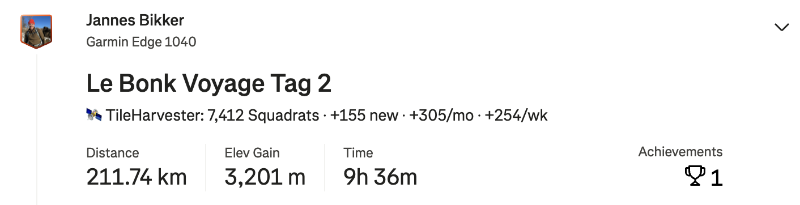

# TileHarvester 🗺️✨

[](Cargo.toml)
[](LICENSE)
[](Dockerfile)

Auto-drop [Squadrats](https://squadrats.com/rules) stats into your Strava activity descriptions. No scraping, no browser extensions, no spam — just a fast, single native Rust binary with bundled SQLite and vibes.

---

## What it does

Outdoor activities that discover new Squadrats get a one-liner appended to their Strava descriptions. Activities with no new Squadrats leave the description untouched.

```text
🗺️ TileHarvester: 1,234 Squadrats · +13 new · +653/mo · +10/wk
```

Set `TH_INCLUDE_SQUADRATINHOS=true` to include fine-grained z17 tiles. New Squadratinhos then qualify an activity for annotation even if it discovers no new Squadrats.

```text
🗺️ TileHarvester: 1,234 Squadrats · +13 new · +653/mo · +10/wk · 12,345 Squadratinhos (+42 new)
```



Plus `tileharvester stats` computes your full local **Squadrats**, **Yard**, **Übersquadrat**, **Squadratinhos**, **Yardinho**, and **Übersquadratinho** — offline, in milliseconds.

Your friends will know you're grinding tiles 🚴‍♂️🏃‍♀️

---

## Quick start ⚡

Grab a prebuilt binary from [GitHub Releases](https://github.com/jb381/TileHarvester/releases) (static Linux `x86_64`/`arm64` musl or macOS `arm64`), or build from source with Cargo:

```bash
# 1. build & install (single ~8 MB binary, zero runtime deps)
git clone https://github.com/jb381/TileHarvester.git && cd TileHarvester
cargo install --path . --locked

# 2. guided one-time setup (credentials → Strava login → history → optional systemd timer)
tileharvester setup
```

`tileharvester setup` prompts for your [Strava API credentials](https://www.strava.com/settings/api), saves them privately (`0600`) to `~/.local/share/tileharvester/.env`, auto-captures the OAuth callback in your browser, seeds your tile history (from Strava or an optional Squadrats KML export), and can install a rootless systemd timer on Linux.

Prefer to script it or run manually? Just authenticate and start syncing — **initial backfill and full-GPS stream refinement happen automatically**:

```bash
export TH_STRAVA_CLIENT_ID="your-id"
export TH_STRAVA_CLIENT_SECRET="your-secret"
tileharvester auth          # auto-captures localhost callback on desktop
tileharvester sync          # auto-backfills on first run, then syncs & refines in the background
```

> **Remote server / SSH tip:** Forward port 8000 (`ssh -L 8000:127.0.0.1:8000 user@server`) and run `tileharvester auth --listen --no-open-browser` — your local browser callback lands cleanly on the remote host without opening any public ports. Over SSH or in headless Docker/Portainer setups, `auth` automatically falls back to pasting the callback URL (or pass `--code <code>`).

Once it works, hand it off to **Docker** or **systemd** for fire-and-forget syncing.

---

## Hosting (set it and forget it)

TileHarvester polls Strava every 5 minutes by default, so it needs **no domain, no TLS cert, and zero open inbound ports** — it runs happily on a Raspberry Pi behind home NAT, a NAS, a $4 VPS, or Coolify/Portainer.

### Docker 🐳

```bash
git clone https://github.com/jb381/TileHarvester.git && cd TileHarvester
cp .env.example .env
# add TH_STRAVA_CLIENT_ID and TH_STRAVA_CLIENT_SECRET to .env

# pull prebuilt multi-arch image (linux/amd64 + linux/arm64 — zero compilation)
docker compose pull

# one-time Strava login (backfill & GPS refinement run automatically after startup!)
docker compose run --rm tileharvester auth

# start continuous background sync
docker compose up -d
docker compose logs -f
```

- **Hardened out of the box:** Runs as non-root UID `10001`, read-only root filesystem, `no-new-privileges`, built-in `HEALTHCHECK` (`tileharvester health --no-check-rate-limit`), automatic log rotation (`10m` × 3), timestamped flushed logs, and clean `SIGTERM` shutdown.
- **Zero babysitting:** The first sync cycle auto-backfills your history, and subsequent cycles quietly refine historical rides to full-GPS accuracy in the background while reserving Strava API quota for new rides.
- **One-off commands:** `docker compose run --rm tileharvester status`, `stats`, or `backup /data/backup.db`.
- **Updating later:** `docker compose pull && docker compose up -d` (or `docker compose up -d --build` for local builds).
- **Upgrading an older root-owned volume:** If your existing `tileharvester-data` volume was created by an older root container, fix ownership once (adjust the volume name if Compose prefixed it):
  ```bash
  docker run --rm -v tileharvester-data:/data alpine chown -R 10001:10001 /data
  ```

### Systemd (Linux bare-metal / Raspberry Pi) 🐧

`tileharvester setup` can install this for you automatically, or run it manually for a rootless user timer with zero idle RAM between runs:

```bash
tileharvester service install --user
loginctl enable-linger "$USER"   # keeps the timer firing after you log out
```

Prefer a system-wide service? Pass `--run-as <user>`:

```bash
sudo tileharvester service install --run-as tileharvester
```

System units automatically include `NoNewPrivileges=true`, `ProtectSystem=strict`, `PrivateTmp=true`, and `ReadWritePaths=<data_dir>`.

---

## Command cheat sheet

| Command | What it does |
| --- | --- |
| `tileharvester setup` | Guided one-time setup: credentials, Strava OAuth, history & optional timer ✨ |
| `tileharvester sync` | Continuous sync daemon (auto-backfills, auto-refines & clean `SIGTERM`) 👀 |
| `tileharvester sync --once` | Run a single sync + background refine cycle 🔄 |
| `tileharvester auth` | Strava OAuth login (auto-listens on desktop, paste fallback on headless/SSH) 🔓 |
| `tileharvester status` | DB, auto-refinement progress, baseline, and auth overview 📊 |
| `tileharvester stats` | Squadrats, Yard, Übersquadrat & Squadratinhos spatial stats 🏆 |
| `tileharvester inspect-gpx <file>` | Audit a local GPX offline: spikes, segments & new tiles 🔎 |
| `tileharvester import-kml <file>` | Seed an exact, immutable Squadrats KML baseline 🧭 |
| `tileharvester compare-kml <file> [--details N]` | Diff local tiles vs. a Squadrats export (with lat/lon) 🎯 |
| `tileharvester backup <path> [--force]` | Safe online SQLite snapshot (`VACUUM INTO`) while syncing 💾 |
| `tileharvester service [print\|install] [--user]` | Generate or install systemd timer units ⚙️ |
| `tileharvester health [--no-check-rate-limit]` | Check DB, Strava auth, and API quota 🩺 |

Power-user commands (`backfill`, `refine`, `recompute`, `recompute-novelty`, `retry`, `validate`, `reset-db`) remain available via `tileharvester --help`, though `sync` handles backfill, stream refinement, and `TH_IGNORED_SPORT_TYPES` recomputes automatically.

---

## How it works

TileHarvester computes tiles from two Strava data sources:

| Source | Accuracy | Speed | Used by |
| --- | --- | --- | --- |
| **Summary polyline** | Lower (simplified corners) | Very fast | Automatic initial backfill |
| **Full GPS stream** | Exact recorded points + moving/distance | Rate-limited | New rides + automatic background refinement |

### Automatic lifecycle

```text
One-time:   tileharvester setup   (or auth + docker compose up -d)
Ongoing:    tileharvester sync    → auto-backfills empty DB on first run
                                  → fetches full GPS streams for every new ride
                                  → trickles full-GPS refinement on older rides (newest-first, quota-safe)
                                  → auto-recomputes if TH_IGNORED_SPORT_TYPES changes
```

- **Instant start, zero rate-limit headaches:** On first sync, TileHarvester imports your full history in seconds using summary polylines so lifetime counts work immediately. Each subsequent sync cycle quietly upgrades a small batch of historical rides (`TH_AUTO_REFINE_PER_CYCLE=5`, newest-first) to full-GPS accuracy while keeping `30%` of Strava's 15-minute and daily API quotas reserved for live rides.
- **Check progress anytime** with `tileharvester status` (`Stream-refined` vs. `Needs stream refinement`), or force an immediate batch with `tileharvester refine`.
- Successful syncs persist a polling cursor and apply an overlap window after downtime so activities are never silently skipped.

### Optional exact Squadrats KML baseline 🧭

Already have years of rides on [squadrats.com](https://squadrats.com)? Export your KML once from the Squadrats desktop map and pass it during `tileharvester setup --kml <file>` (or run `import-kml` anytime) for an exact starting point with zero historical backfill or refinement needed:

```bash
# Seed exact Squadrats + Squadratinhos snapshot (immutable once imported)
tileharvester import-kml ~/Downloads/squadrats-2026-08-01.kml

# Audit drift anytime against newer exports (shows mismatched tile IDs + coordinates)
tileharvester compare-kml ~/Downloads/squadrats-latest.kml --details 20
```

Pass `--as-of 2026-08-01T18:43:00+02:00` if you know the exact export time; otherwise the import timestamp is used. From that point forward, lifetime totals start exact and weekly, monthly, and per-activity `+new` counts accumulate from new Strava rides.

### Rebuilding totals & manual offset

- **Changing `TH_IGNORED_SPORT_TYPES`** triggers an automatic local recompute on the next `sync` (preserving already stream-refined rides). You can also run `tileharvester recompute` or `tileharvester recompute-novelty` manually anytime.
- **Manual offset** — nudge the displayed lifetime Squadrat total without touching weekly/monthly counts:
  ```bash
  tileharvester sync --once --offset +5   # or set TH_SQUADRAT_OFFSET=+5 in .env
  ```

---

## Under the hood: accuracy & speed 🚀

Instead of naive point-in-tile sampling (which misses corners on 5-second Wahoo/watch tracks) or naïve line interpolation, TileHarvester runs a **drift-free Web Mercator DDA traversal** (`asinh(tan(lat))`) with canonicalized antimeridian unwrapping and single-pass `z17 → z14` bit-shift derivation.

- **Analytic geometry proof:** **0 mismatches across 10,017** randomized and adversarial segments against an independent Liang–Barsky geometric oracle (100% reversal symmetry and z14/z17 parent-child parity).
- **Smart GPS cleaning:** Fetches `latlng,time,moving,distance` in a single Strava API call (with graceful fallback) to filter isolated spikes, 2–3 point spike bursts, cold-start/stop endpoint glitches, sub-50 m z17 urban-canyon multipath bounces, and stationary coffee-stop drift — while bridging corroborated tunnel dropouts and splitting real transfers.

### Real-world audit & benchmarks

Audited on **1,206 real outdoor activities (6.94M GPS points)** against an official **10,030-Squadrat / 99,536-Squadratinho** Squadrats KML export:

| Metric | Result | Notes |
| --- | --- | --- |
| **Squadrats (z14)** | **99.98% precision / 99.98% recall** | 10,028 / 10,030 tiles shared |
| **Squadratinhos (z17)** | **99.86% precision / 99.91% recall** | 99,448 / 99,536 tiles shared |
| **Spatial metrics** | **4 / 4 exact** | Yard (964), Übersquadrat (24×24), Yardinho (349), Übersquadratinho (9×9) |
| **GPS throughput** | **2.76 s** for 6.94M points | ~2.5M points/sec |
| **Dissolved KML parse** | **146 ms** for 2.55 MB (109k tiles) | Edge-bucketed scanline rasterizer |
| **SQLite history rebuild** | **27.9 ms** for 500 activities | 8.7× faster via covering PK scan |
| **Yard / Übersquadratinho** | **5.15 ms** for 25,000 z17 tiles | Exact 4-neighbor BFS + DP |

Remaining sub-0.2% z17 differences versus raw FIT archives come from 5-decimal Strava polyline precision vs. 7-decimal device FIT coordinates (which shifts border crossings) and Strava-trimmed activities. Benchmark timings depend on hardware and dataset.

---

## Configuration ⚙️

Supply settings via environment variables, `./.env`, or `~/.local/share/tileharvester/.env` (process environment wins over `./.env`, which wins over `<data_dir>/.env`). See [`.env.example`](.env.example) for the full list.

| Variable | Purpose & default |
| --- | --- |
| `TH_STRAVA_CLIENT_ID`, `TH_STRAVA_CLIENT_SECRET` | Strava API credentials *(required; `setup` can save these for you)* |
| `TH_DATA_DIR` | SQLite DB, tokens & persisted `.env` directory (`~/.local/share/tileharvester`, `/data` in Docker) |
| `TH_POLL_INTERVAL_MINUTES` | Sync polling interval in minutes (`5`) |
| `TH_AUTO_REFINE` | Automatically refine historical rides to full GPS during `sync` (`true`) |
| `TH_AUTO_REFINE_PER_CYCLE` | Max historical rides auto-refined per sync cycle (`5`) |
| `TH_AUTO_REFINE_RESERVE_PCT` | Minimum % of Strava 15-min & daily quota kept reserved for live rides (`30`) |
| `TH_SQUADRAT_OFFSET` | Lifetime Squadrat display offset (`0`) |
| `TH_INCLUDE_SQUADRATINHOS` | Append Squadratinhos to Strava descriptions (`false`) |
| `TH_IGNORED_SPORT_TYPES` | Comma-separated excluded sports (`VirtualRide,VirtualRun`) |
| `TH_STREAM_MAX_POINTS` | Max GPS points per activity stream (`250000`) |
| `TH_REWRITE_EXISTING_ANNOTATIONS` | Rewrite prior annotations after recompute (`false`) |

---

## Recovery & safety notes

- **Automatic retries:** Failed processing retries on the next sync; failed annotations retry while inside the annotation window (use `tileharvester retry` for older failures). `sync --once` exits non-zero if anything fails.
- **No silent truncation:** Refinement keeps existing tiles if Strava errors out. Ultra-long activities above `TH_STREAM_MAX_POINTS` (default `250,000`) fail loudly instead of saving truncated routes — raise the limit and retry.
- **Atomic KML imports:** Baseline import and novelty rebuilds run atomically inside SQLite transactions, with XML DTD/entity rejection and rasterization guardrails (2M tiles/layer, 50M scan ops/ring).
- **Safe backups:** Use `tileharvester backup <path>` instead of copying `tileharvester.db` directly while the daemon is running.

---

## Development, testing & benchmarking 🛠️

Requires **Rust 1.85+**. The **152-test suite** covers unit tests, CLI binary behavior, workflow integration, regressions, the Liang–Barsky geometric oracle, multi-device Squadratinho stress cases, and real loopback HTTP OAuth/retry mocks.

```bash
cargo test --all-targets --locked
cargo bench --bench engine_benchmarks
cargo fmt --all -- --check
cargo clippy --all-targets --locked -- -D warnings
cargo build --release --locked
```

See [CHANGELOG.md](CHANGELOG.md) for release history.

---

## License 📄

MIT — use it, fork it, grind tiles.
